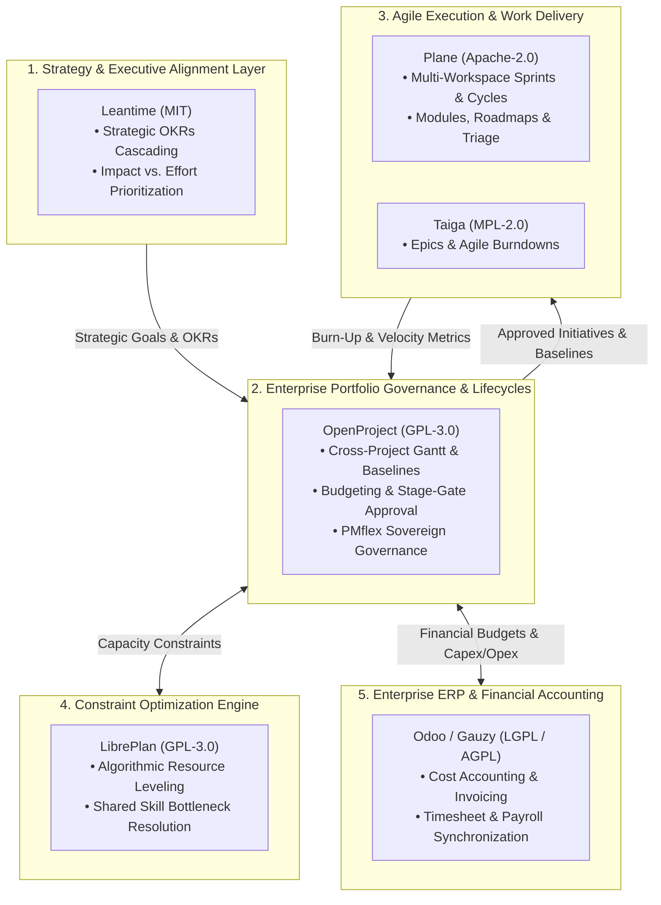

  

  
  
  
  
  
  

---

# 🚀 Awesome Strategic Portfolio Management (SPM)

> **A comprehensive, SEO-optimized curated directory of enterprise SaaS suites and sovereign open-source GitHub projects for Strategic Portfolio Management (SPM), Project Portfolio Management (PPM), OKR Alignment, and Value Stream Governance.**

**Strategic Portfolio Management (SPM)** empowers C-suite executives, Enterprise PMOs (E-PMOs), Portfolio Directors, and Chief Information Officers (CIOs) to bridge the chasm between business strategy and operational execution. SPM platforms orchestrate continuous portfolio prioritization, dynamic resource capacity leveling, stage-gate governance, enterprise agile planning (EAP / SAFe), and financial return on investment (ROI) tracking.

---

## 📑 Table of Contents

- [🌐 Sector Overview & Market Dynamics](#-sector-overview--market-dynamics)
- [🏢 Enterprise SaaS & Hosted SPM Platforms](#-enterprise-saas--hosted-spm-platforms)
- [🔓 Open-Source GitHub Projects](#-open-source-github-projects)
- [⚖️ Key Differences: Traditional PPM vs. Strategic SPM](#️-key-differences-traditional-ppm-vs-strategic-spm)
- [🧩 Architecting Sovereign SPM: Open-Source Reference Stack](#-architecting-sovereign-spm-open-source-reference-stack)
- [❓ Frequently Asked Questions (FAQ)](#-frequently-asked-questions-faq)
- [🤝 How to Contribute](#-how-to-contribute)
- [💖 Support & Sponsoring](#-support--sponsoring)
- [📈 Star History](#-star-history)
- [📜 Disclaimer & License](#-disclaimer--license)

---

## 🌐 Sector Overview & Market Dynamics

The global **Strategic Portfolio Management (SPM)** market size was valued at **$3.5 billion to $4.2 billion in 2024** and is projected to surpass **$8.5 billion to $10.8 billion by 2032**, expanding at a compound annual growth rate (**CAGR of 13.5% to 15.2%**). 

The market dynamics exhibit a **moderately concentrated** market structure at the enterprise tier: massive conglomerate ecosystems—such as **Broadcom (Clarity)**, **Adobe (Workfront)**, **IBM (Apptio Targetprocess)**, **ServiceNow (SPM)**, and **Atlassian (Jira Align)**—dominate Global 2000 digital transformations with bundled platform lock-in. Concurrently, high-velocity pure-play leaders (e.g., **Planview**, **Meisterplan**, **Shibumi**) command significant share in specialized agile planning and scenario modeling. In parallel, data privacy mandates, sovereignty regulations (GDPR/PMflex), and ballooning per-seat SaaS costs are accelerating adoption of **self-hosted open-source portfolio ecosystems** like **Plane**, **OpenProject**, **Odoo**, and **Leantime**.

---

## 🏢 Enterprise SaaS & Hosted SPM Platforms

The table below lists the category-defining SaaS and hosted Strategic Portfolio Management solutions, sorted **descending by company size, market valuation, and annualized revenue**.

| 🏢 Platform | 💰 Company Valuation / Revenue | 🏷️ Starting Tier Pricing | ⏳ Free Tier / Free Trial Limits | 🎯 Key SPM Capabilities & Focus Areas |
| :--- | :--- | :--- | :--- | :--- |
| **[Broadcom Clarity](https://www.broadcom.com/products/software/enterprise-software/clarity-ppm)** | **~$850B+ Market Cap** *(~$51.6B Annual Rev, NASDAQ: AVGO)* | **~$35 – $120 / user / month** *(Tier-1 partner hosted starts at ~$35/user/mo; direct SaaS list ~$65–$120/user/mo; annual contract)* | **No free forever tier**. 30-day proof-of-concept / evaluation sandbox via certified Broadcom partners (e.g., Rego Consulting, Winmill PPM). | Enterprise-scale project portfolio governance, investment roadmapping, resource capacity planning, financial budgeting, and earned value management for Fortune 500 PMOs. |
| **[Adobe Workfront](https://www.adobe.com/products/workfront.html)** | **~$220B+ Market Cap** *(~$21.4B Annual Rev, NASDAQ: ADBE)* | **~$30 – $40 / user / month** *(Select tier baseline; Prime & Ultimate tiers quote-based; annual billing)* | **No free forever tier**. 14-day interactive guided evaluation demo/sandbox environment arranged via enterprise sales consultation. | Enterprise collaborative work management, cross-departmental portfolio prioritization, digital asset integration, and strategic capacity forecasting. |
| **[Apptio Targetprocess](https://www.apptio.com/products/targetprocess/)** *(IBM)* | **~$200B+ Market Cap** *(Parent IBM $62.6B Rev; Acquired Apptio for $4.6B)* | **~$15 – $32 / user / month** *(Team tier via G-Cloud procurement; Enterprise Scaled Agile tiers priced via enterprise agreements)* | **30-day full free trial**. Comprehensive access with unlimited evaluation users, agile entities, custom portfolio boards, and SAFe visualizers. | Agile Portfolio Management, Scaled Agile Framework (SAFe 6.0) alignment, Lean budgeting, value stream mapping, and corporate objective orchestration. |
| **[ServiceNow SPM](https://www.servicenow.com/products/strategic-portfolio-management.html)** | **~$185B+ Market Cap** *(~$10.0B Annual Rev, NYSE: NOW)* | **~$75 – $100 / fulfiller / month** *(SPM module add-on for Now Platform; typical annual enterprise contract threshold applies)* | **No free forever commercial tier**. 15-day Personal Developer Instance (PDI) with SPM modular plugins on Now Platform, or 30-day enterprise POC. | Complete strategy-to-execution lifecycle: business capability mapping, enterprise demand management, multi-year portfolio roadmaps, and digital portfolio workbooks. |
| **[Jira Align](https://www.atlassian.com/software/jira/align)** *(Atlassian)* | **~$48B+ Market Cap** *(~$4.4B Annual Rev, NASDAQ: TEAM)* | **$77,400 / year base entry tier** *(Covers 1 to 50 full users, equivalent to ~$129/user/mo; unlimited free integrated Jira users included)* | **No free forever tier for Align**. 30-day guided enterprise proof-of-concept / pilot program provided via Atlassian Solutions Partners (standard Jira offers free tier up to 10 users). | Enterprise Agile Planning (EAP), connecting board-level OKRs to team backlog execution, Portfolio Kanban, Program Increment (PI) planning, and SAFe value streams. |
| **[Planview](https://www.planview.com/)** | **~$1.6B – $2.0B Valuation** *(~$450M – $500M ARR; TPG & Thoma Bravo PE-backed)* | **$29 / user / month** *(Planview AgilePlace/ProjectPlace starts at $29/user/mo; Planview Portfolios starts at ~$45–$65/user/mo)* | **30-day free trial** on ProjectPlace & AgilePlace. Full collaborative workspace, Kanban and Gantt access; enterprise Portfolios evaluation sandbox available on request. | Strategy execution management, adaptive portfolio management, enterprise resource capacity balancing, OKR orchestration, and value stream analytics. |
| **[Sciforma](https://www.sciforma.com/)** | **~$150M+ Est. Valuation** *(~$40M – $50M ARR; STG Private Equity portfolio)* | **~$30 – $45 / user / month** *(Billed annually; tiered modular licensing for managers, contributors, and viewers)* | **No free forever tier**. 14-day guided sandbox proof-of-concept environment upon custom demo request and qualification. | Idea and demand pipeline screening, stage-gate lifecycle governance, critical chain scheduling, and multi-project resource capacity leveling. |
| **[Cora PPM](https://www.corappm.com/)** | **~$100M+ Est. Valuation** *(~$25M – $35M ARR; Growth equity backed)* | **~$25 – $50 / user / month equivalent** *(Platform tier model with unlimited user access options; starting platform bundles from ~$1,500/mo)* | **No free forever tier**. 30-day hosted evaluation sandbox available upon request, configured with pre-loaded enterprise PPM scenario templates. | Large-scale capital project portfolio governance, predictive cost and earned value management (EVM), strategic alignment scorecards, and defense/engineering PPM. |
| **[Meisterplan](https://meisterplan.com/)** | **~$18M – $22M ARR** *(itdesign GmbH, profitable private/bootstrapped)* | **$600 / month flat baseline** *(Basic tier covers 50 resources with unlimited free users; Pro tier with What-If scenario simulations starts at $800/mo)* | **30-day full free trial**. Complete Pro Edition access with up to 500 planned resources, unlimited users, pre-configured sample datasets, no credit card required. | Lean portfolio management, real-time What-If scenario simulations, resource capacity bottleneck resolution, and interactive priority rank matrices. |
| **[Shibumi](https://www.shibumi.com/)** | **~$60M – $80M Est. Valuation** *(~$12M – $15M ARR; Venture/growth funded)* | **~$35 – $50 / user / month** *(Billed annually with minimum entry bundle commitments of 25–50 seats)* | **No free forever tier**. 14-day custom enterprise pilot trial with custom strategic initiative blueprints and executive dashboard templates. | Strategic program governance, digital transformation delivery, cost optimization realization tracking, and RPA/automation portfolio value realization. |

---

## 🔓 Open-Source GitHub Projects

For organizations requiring total data sovereignty, zero per-seat licensing fees, custom ERP integrations, or regulatory compliance (e.g., German federal **PMflex**, ISO 21500), these active open-source solutions provide robust project, portfolio, and work management capabilities.

The projects are sorted **descending by GitHub Stars_Count**.

### 1. ✈️ [Plane](https://github.com/makeplane/plane) 
- **Repository**: [`makeplane/plane`](https://github.com/makeplane/plane)  
- **License**: Apache-2.0 | **Primary Tech**: TypeScript, Python, React, Docker  
- **Overview**: An open-source, modern alternative to Jira, Linear, Monday, and ClickUp. Supports multi-project workspaces, Cycles (sprints), Modules (epics/programs), roadmaps, cross-team triage boards, and fine-grained role-based governance. Ideal for software engineering organizations transitioning towards product-centric portfolio management.

### 2. 💼 [Odoo (Project & Portfolio Module)](https://github.com/odoo/odoo) 
- **Repository**: [`odoo/odoo`](https://github.com/odoo/odoo)  
- **License**: LGPL-3.0 | **Primary Tech**: Python, JavaScript, PostgreSQL  
- **Overview**: The widely deployed open-source business application suite. The Project and Timesheet ecosystem connects directly with community portfolio extensions (such as Project Portfolio and Resource Capacity Planning), enabling enterprise-grade multi-project cost accounting, budget variance tracking, and unified CRM/HR resource orchestration.

### 3. 📋 [Focalboard](https://github.com/mattermost-community/focalboard) 
- **Repository**: [`mattermost-community/focalboard`](https://github.com/mattermost-community/focalboard)  
- **License**: AGPL-3.0 / MIT | **Primary Tech**: Go, TypeScript, React  
- **Overview**: A self-hosted, multilingual project and work coordination system from Mattermost (an open-source alternative to Trello, Notion, and Asana). Provides kanban boards, interactive tables, calendars, and timeline cards suited for coordinating portfolio initiatives and tracking deliverable milestones.

### 4. 🗂️ [Wekan](https://github.com/wekan/wekan) 
- **Repository**: [`wekan/wekan`](https://github.com/wekan/wekan)  
- **License**: MIT | **Primary Tech**: JavaScript, Meteor, Node.js, MongoDB  
- **Overview**: A battle-tested open-source kanban system that supports multi-board organizational hierarchies, swimlanes, custom field formulas, webhook automation, and distributed team synchronization. Highly popular for on-premise deployments where simplicity and data privacy are paramount.

### 5. 🏗️ [OpenProject](https://github.com/opf/openproject) 
- **Repository**: [`opf/openproject`](https://github.com/opf/openproject)  
- **License**: GPL-3.0 | **Primary Tech**: Ruby on Rails, Angular, PostgreSQL  
- **Overview**: The leading open-source enterprise project and portfolio management software. Delivers multi-level project hierarchies, portfolio overviews, interactive Gantt charts with cross-project dependency tracking, detailed budget tracking, time management, and agile boards (Kanban/Scrum/SAFe). Features specialized configurations for the German public administration standard (**PMflex**).

### 6. 📌 [Planka](https://github.com/plankanban/planka) 
- **Repository**: [`plankanban/planka`](https://github.com/plankanban/planka)  
- **License**: AGPL-3.0 | **Primary Tech**: Node.js, React, Redux, PostgreSQL  
- **Overview**: An open-source real-time collaborative tracking board. Enables PMO teams to establish cross-functional project boards, track user time, attach documentation, and manage multi-team assignments with a modern, performant interface.

### 7. 🎯 [Leantime](https://github.com/Leantime/leantime) 
- **Repository**: [`Leantime/leantime`](https://github.com/Leantime/leantime)  
- **License**: MIT | **Primary Tech**: PHP, JavaScript, MySQL  
- **Overview**: A strategy-first open-source project management platform purpose-built for non-project managers and executive leadership. Features native OKR (Objectives and Key Results) cascading, an effort-versus-impact Goal Matrix for priority scoring, idea validation boards, and cross-project portfolio health dashboards.

### 8. 📊 [Kanboard](https://github.com/kanboard/kanboard) 
- **Repository**: [`kanboard/kanboard`](https://github.com/kanboard/kanboard)  
- **License**: MIT | **Primary Tech**: PHP, SQLite / MySQL / PostgreSQL  
- **Overview**: A minimalist, high-speed visual task and project management software. Highlights include automated actions (e.g., auto-assigning or moving tasks based on criteria), cross-project subtask rollups, cumulative flow analytics, and Gantt charts with zero operational overhead.

### 9. 📈 [Ever Gauzy](https://github.com/ever-co/ever-gauzy) 
- **Repository**: [`ever-co/ever-gauzy`](https://github.com/ever-co/ever-gauzy)  
- **License**: AGPL-3.0 | **Primary Tech**: TypeScript, NestJS, Angular, TypeORM  
- **Overview**: Open-source business and resource management platform combining ERP, project management, and resource scheduling. Delivers cross-project employee time tracking, contractor cost allocation, project budget accounting, and team capacity visualization.

### 10. 🛡️ [GLPI (with ProjectBridge)](https://github.com/glpi-project/glpi) 
- **Repository**: [`glpi-project/glpi`](https://github.com/glpi-project/glpi)  
- **License**: GPL-3.0 | **Primary Tech**: PHP, MariaDB/MySQL  
- **Overview**: Open-source IT Service Management (ITSM) and asset management suite. When equipped with project modules and the ProjectBridge plugin, GLPI links IT change requests, service catalog demands, capital assets, and PMO initiatives into a cohesive IT portfolio governance environment.

### 11. 🔴 [Redmine](https://github.com/redmine/redmine) 
- **Repository**: [`redmine/redmine`](https://github.com/redmine/redmine)  
- **License**: GPL-2.0 | **Primary Tech**: Ruby on Rails, MySQL / PostgreSQL  
- **Overview**: A venerable, flexible open-source web-based project management system. Through modular community plugins (e.g., *Redmine Portfolio Management*, *Redmine Agile*, and *Resource Heatmaps*), Redmine provides multi-project roadmaps, cross-initiative Gantt views, and custom role security with total deployment sovereignty.

### 12. ✅ [Vikunja](https://github.com/go-vikunja/vikunja) 
- **Repository**: [`go-vikunja/vikunja`](https://github.com/go-vikunja/vikunja)  
- **License**: AGPL-3.0 | **Primary Tech**: Go, Vue.js, SQLite/PostgreSQL/MySQL  
- **Overview**: A modern, responsive self-hosted task and initiative manager. Organizes complex work into namespaces and nested projects, offering Kanban boards, interactive Gantt timelines, recurring tasks, and granular team collaboration.

### 13. ⏱️ [Taiga](https://github.com/taigaio/taiga-docker) 
- **Repository**: [`taigaio/taiga-docker`](https://github.com/taigaio/taiga-docker)  
- **License**: MPL-2.0 | **Primary Tech**: Python (Django), AngularJS, PostgreSQL, Docker  
- **Overview**: An agile project management platform designed for agile teams, designers, and software project managers. Features epic hierarchies spanning multiple underlying projects, multi-team Scrum and Kanban boards, burndown charts, and cross-project backlog prioritization.

### 14. 📐 [LibrePlan](https://github.com/LibrePlan/libreplan) 
- **Repository**: [`LibrePlan/libreplan`](https://github.com/LibrePlan/libreplan)  
- **License**: GPL-3.0 | **Primary Tech**: Java, ZK Framework, PostgreSQL  
- **Overview**: A web-based project planning tool engineered around an algorithmic, resource-constrained scheduling engine. Automatically balances and levels shared resources across concurrent initiatives with critical path analysis. Tailored for manufacturing, engineering, and infrastructure portfolios.

### 15. 🍊 [Orangescrum Community](https://github.com/Orangescrum/opensource-community-edition) 
- **Repository**: [`Orangescrum/opensource-community-edition`](https://github.com/Orangescrum/opensource-community-edition)  
- **License**: AGPL-3.0 | **Primary Tech**: CakePHP, PostgreSQL, Docker  
- **Overview**: A clean open-source project management platform featuring interactive Scrum/Kanban boards, project milestones, resource availability views, time tracking with billable logs, and financial invoicing without per-seat licensing fees.

---

## ⚖️ Key Differences: Traditional PPM vs. Strategic SPM

Modern organizations are rapidly shifting from tactical Project Portfolio Management (PPM) to outcome-focused Strategic Portfolio Management (SPM):

| 🔍 Dimension | 🗃️ Traditional PPM | 🎯 Strategic Portfolio Management (SPM) |
| :--- | :--- | :--- |
| **Primary Objective** | Delivering projects on time, within scope, and under budget (*Execution Focus*). | Maximizing business outcomes, strategic alignment, and digital ROI (*Value Focus*). |
| **Planning Horizon** | Annual or bi-annual rigid budgeting cycles. | Continuous, dynamic quarterly funding and adaptive portfolio reprioritization. |
| **Prioritization Driver** | First-in, first-out or executive sponsor influence. | Multi-criteria scoring, OKR contribution, risk-adjusted value, and cost-of-delay. |
| **Resource Management** | Static resource assignments and rigid timesheets. | Dynamic capacity planning, skill-based leveling, and scenario simulation. |
| **Agile Integration** | Disconnected from team backlogs (MS Project / Gantt siloes). | Unified Enterprise Agile Planning (EAP) bridging OKRs directly to Jira/Plane cycles. |
| **Risk & Change Model** | Rigid change-request boards with escalation delays. | Real-time What-If scenario modeling and continuous feedback loops. |

---

## 🧩 Architecting Sovereign SPM: Open-Source Reference Stack

For enterprise PMOs and public sector organizations requiring a sovereign, completely self-hosted Strategic Portfolio Management ecosystem, consider assembling this proven open-source reference architecture:

---

## ❓ Frequently Asked Questions (FAQ)

### What makes a software platform qualifying as SPM instead of basic project management?
Basic project management tools (like Trello, Asana, or standard Jira) track individual tasks, sprints, and checklists for a single team. In contrast, **Strategic Portfolio Management (SPM)** operates at the enterprise level: it evaluates hundreds of initiatives simultaneously, assesses strategic fit against OKRs, models dynamic What-If scenarios under constrained budgets/capacity, and provides continuous value governance.

### Can open-source SPM platforms scale to large organizations?
Yes. Platforms like **OpenProject** and **Odoo** are deployed by federal ministries (e.g., the German Federal Ministry with PMflex), multinational automotive firms, and universities with tens of thousands of active users. Combined with containerized microservices (Docker/Kubernetes) and robust databases (PostgreSQL), open-source stacks offer high availability, zero per-seat licensing tax, and air-gapped security.

### How do organizations transition from annual budgeting to continuous SPM?
Organizations typically adopt **Lean Portfolio Management (LPM)** principles:
1. Transition from funding disconnected projects to funding cross-functional **Value Streams**.
2. Establish quarterly **Participatory Budgeting** and Program Increment (PI) planning sessions.
3. Use dynamic scenario simulation tools (e.g., Meisterplan or Leantime) to adjust roadmap allocations as market conditions shift.

---

## 🤝 How to Contribute

Contributions, tool suggestions, and pricing updates from the global PMO and engineering community are warmly welcome!

1. 🍴 **Fork the repository** on GitHub.
2. 🌿 **Create a feature branch** (`git checkout -b feature/add-new-spm-tool`).
3. 📝 **Add or update entries in `README.md`** following the existing tabular or markdown formatting standards:
   - Provide exact vendor or open-source pricing (no generic terms like 'Custom' or 'Usage-based').
   - Include specific free trial terms and company scale metrics.
   - For open-source tools, include the standard shields.io Stars_Badge (`style=social&color=white`) linking to `/stargazers`.
4. 🚀 **Commit your changes** (`git commit -m 'feat: add new SPM open-source platform'`).
5. 📬 **Submit a Pull Request** with a concise description of your additions.

Explore more curated lists in the [Awesome-Awesome-Awesome](https://github.com/ishandutta2007/Awesome-Awesome-Awesome) index!

---

## 💖 Support & Sponsoring

If this curated directory has helped you evaluate platforms, optimize PMO processes, or design your enterprise architecture, please consider supporting ongoing maintenance:

- ⭐ **Star this repository** on GitHub to amplify its reach.
- 🍴 **Fork and share** with your network, PMO peers, and agile communities.
- ☕ **Sponsor the maintainer** via the [GitHub Sponsor Dashboard](https://github.com/sponsors/ishandutta2007) to support continuous open-source research and directory upkeep.

---

## 📈 Star History

---

## 📜 Disclaimer & License

- This repository is a community-curated, independent directory provided for educational, architectural, and procurement evaluation purposes. All trademarks, company names, and logos are the property of their respective owners.
- Platform pricing, trial policies, and feature tiers change over time; verify exact terms with official vendor documentation prior to commercial commitments.
- Released under the [MIT License](LICENSE).
